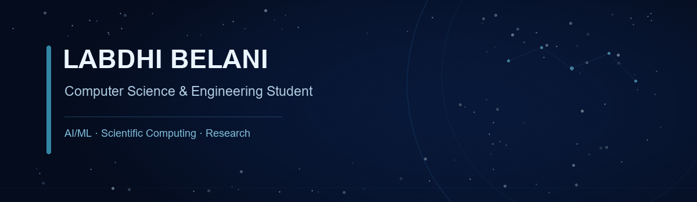

---

## About Me

<table>
  <tr>
    <td width="70%" valign="middle">

I'm a first-year B.Tech undergraduate in Computer Science and Engineering, building a foundation in programming, mathematics, algorithms, and computer systems.

My primary interests lie in Artificial Intelligence and Machine Learning, particularly their research applications. I'm curious about how learning algorithms work, how models can be evaluated and interpreted, and how computational methods can help investigate complex scientific problems.

I use this space to document my learning, explore research ideas, and share technical work as I develop it.

</td>
    <td width="10%" align="center" valign="middle">
      
    </td>
  </tr>
</table>

</table>

<table>
  <thead>
    <tr>
      <th align="center">Area</th>
      <th align="center">Technologies</th>
    </tr>
  </thead>
  <tbody>
    <tr>
      <th align="center">Languages</th>
      <td>
        
        
      </td>
    </tr>
    <tr>
      <th align="center">Tools</th>
      <td>
        
        
      </td>
    </tr>
    <tr>
      <th align="center">Coursework</th>
      <td>
        
        
        
      </td>
    </tr>
    <tr>
      <th align="center">Exploring</th>
      <td>
        
        
        
      </td>
    </tr>
  </tbody>
</table>

## Connect with me

