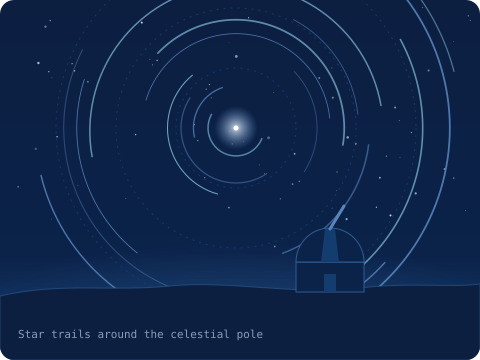
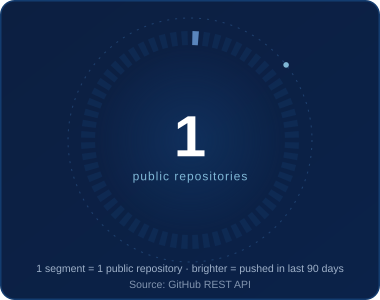
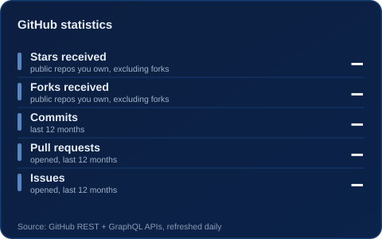
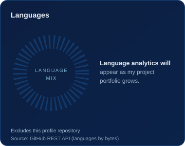
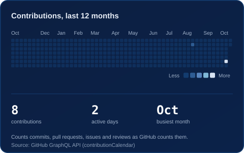

## About me

<table>
<tr>
<td width="60%" valign="middle">

Hi, I'm **Labdhi Belani**, a first-year Computer Science & Engineering student building strong foundations in programming, operating systems, discrete mathematics and digital logic, while exploring AI/ML and scientific computing.

I like research-style "why" questions. This profile is where I document what I'm learning and building.

</td>
<td width="40%" valign="middle">

</td>
</tr>
</table>

### Current Focus

- **Programming:** Building a strong foundation in C and Python.
- **Computer Science:** Studying operating systems, digital logic and discrete mathematics.
- **Problem Solving:** Practising programming fundamentals and algorithmic thinking.
- **Exploring:** AI/ML foundations and scientific computing.

*Learning in public, one concept and one project at a time.*

---

## Connect with me

---

## Tech stack

Labelled by where I actually am with each one.

| Area | Technologies |
|---|---|
| **Languages** |   |
| **Tools** |   |
| **Coursework** |    |
| **Exploring** |  |

<!-- Add a badge only when it's true. Pattern:
https://img.shields.io/badge/<Label>-<status>-133C6F?style=flat-square&logo=<simple-icons-slug>&logoColor=white&labelColor=0B2249 -->

---

## Projects in development

**Scientific Literature Contradiction Finder** · *prototype, university project*

- **Problem:** Papers on the same question can seem to disagree. Is it a genuine contradiction, or a difference in context?
- **Approach:** An LLM (Gemini) compares papers directly and returns structured JSON that classifies each apparent disagreement as genuine, contextual, partial, or lacking evidence, instead of summarising each paper alone. The first test case is four sim-to-real robotics papers.
- **Built with:** Python, Streamlit, Gemini API
- **Status:** In development. Repository not public yet.

<!-- When the repo is public, add a line:  - **Repository:** [Labdhicodez/REPO-NAME](https://github.com/Labdhicodez/REPO-NAME)
Add the next project below in the same format. Keep this list to the best 2-3 projects. -->

---

## GitHub analytics

All figures are generated from my GitHub data by a daily workflow, with nothing typed by hand. An empty card means there isn't data to show yet.

 

<!--STATS:START-->
**Live snapshot:** will appear after the first automated update (Actions → Update profile stats → Run workflow).
<!--STATS:END-->

How these numbers are measured

- **Public repositories:** account total from the GitHub REST API (includes forks and this profile repository). Each ring segment is one repository; brighter segments were pushed to in the last 90 days. The ring shows up to 60.
- **Stars and forks:** summed over my public, non-fork repositories.
- **Commits, pull requests, issues, contributions:** GitHub GraphQL `contributionsCollection` over the last 12 months. Private activity only appears if I've enabled it in my profile settings.
- **Languages:** bytes of code per language across my public, non-fork project repositories, as classified by GitHub. This profile repository is excluded because it only holds this page and its generator. It measures code volume, not skill.

Generated by <a href="scripts/generate-stats.mjs">scripts/generate-stats.mjs</a> and refreshed by <a href=".github/workflows/update-stats.yml">GitHub Actions</a>.

